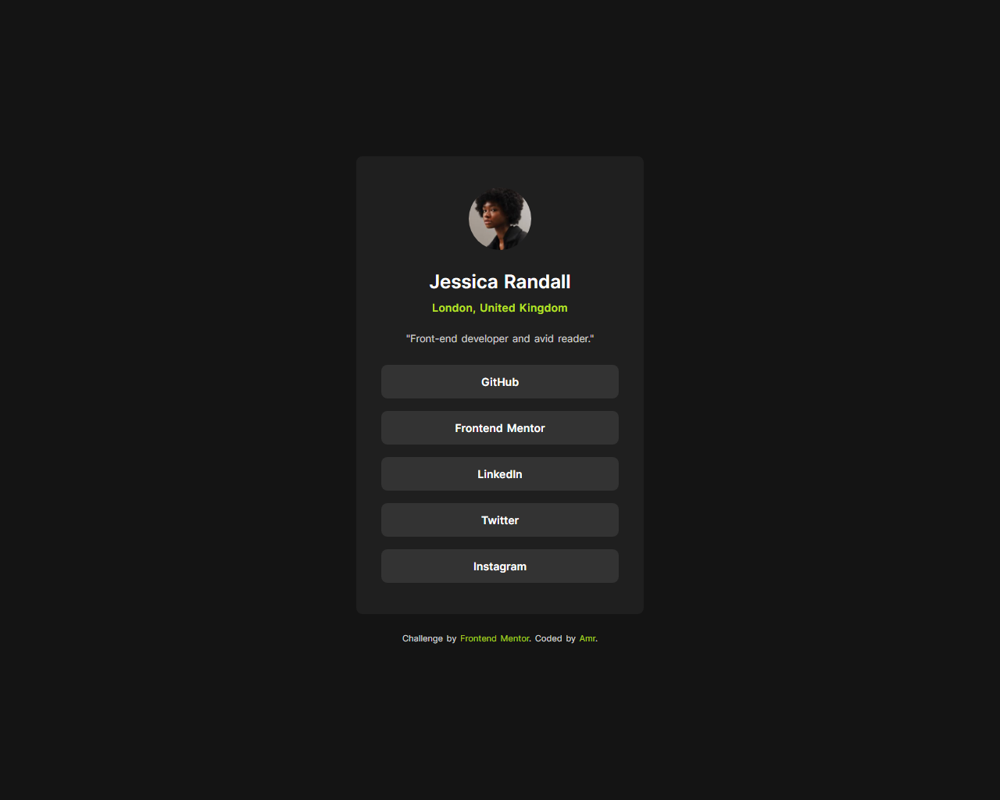

# Frontend Mentor - Social links profile solution

This is a solution to the [Social links profile challenge on Frontend Mentor](https://www.frontendmentor.io/challenges/social-links-profile-UP32lGUuw). Frontend Mentor challenges help you improve your coding skills by building realistic projects.

## Table of contents

- [Overview](#overview)
  - [The challenge](#the-challenge)
  - [Screenshot](#screenshot)
  - [Links](#links)
- [My process](#my-process)
  - [Built with](#built-with)
  - [What I learned](#what-i-learned)
- [Author](#author)

## Overview

### The challenge

Users should be able to:

- See hover and focus states for all interactive elements on the page.
- View a responsive layout that adapts cleanly across different screen sizes.

### Screenshot

### Links

- Solution URL: [Add solution URL here](https://your-solution-url.com)
- Live Site URL: [Add live site URL here](https://your-live-site-url.com)

## My process

### Built with

- Semantic HTML5 markup (`main`, `ul`, `li`, `footer`)
- CSS custom properties (`:root`)
- CSS Grid (`minmax(0, 1fr)`) and Flexbox layout
- Logical CSS properties (`inline-size`, `block-size`, `padding-inline`, `padding-block`, `margin-block-start`) and `rem` units
- Local `@font-face` implementation for the `Inter` font family

### What I learned

In this challenge, I practiced building a responsive card layout without unnecessary media queries using `inline-size: 100%`, `max-inline-size`, and `minmax(0, 1fr)`. I also focused on clear `:hover` and `:focus-visible` states, color contrast on a dark surface, and fine-tuning vertical spacing so compact viewports fit comfortably without unwanted vertical scroll.

## Author

- Name - Amr
- Frontend Mentor - [@mrws4589-code](https://www.frontendmentor.io/profile/mrws4589-code)
- GitHub - [@mrws4589-code](https://github.com/mrws4589-code)